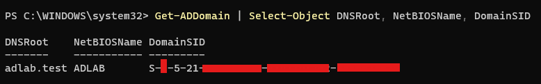
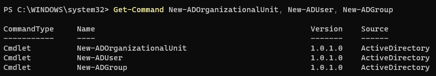
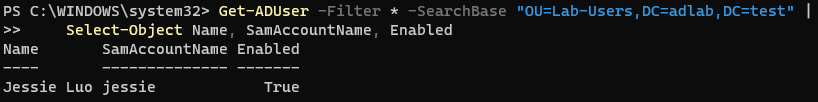
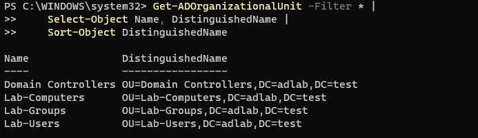
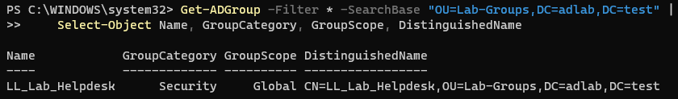
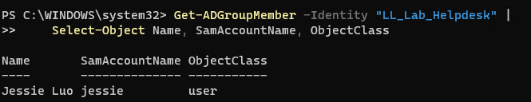

# Lab 09 — Create Test Users, Groups, and Organisational Units

## 1. Objective

Create a basic Active Directory structure containing organisational units (OUs), a test user, and a security group. Add the test user to the group and verify the directory objects.

## 2. Lab Environment

| Item | Configuration |
|---|---|
| Domain Controller | `DC01` |
| Domain Name | `adlab.test` |
| NetBIOS Domain Name | `ADLAB` |
| Client Computer | `CLIENT01` |
| Parent OU | `Lab-Objects` |
| User OU | `Lab-Users` |
| Group OU | `Lab-Groups` |
| Computer OU | `Lab-Computers` |
| Test User | `jessie.luo` |
| Security Group | `IT-Support-Test` |

## 3. Prerequisites

Before starting, confirm:

- [ ] DC01 is running.
- [ ] The `adlab.test` domain is operational.
- [ ] Active Directory Domain Services is installed.
- [ ] You can sign in to DC01 with an account that has permission to create AD objects.
- [ ] Lab 08 has been completed, or the domain-join status has been checked.

**Important:** Run the commands in this lab on **DC01**, using PowerShell as Administrator. Do not run them on CLIENT01.

## 4. Procedure

### Step 1 — Confirm the domain and Active Directory module

On DC01, open PowerShell as Administrator.

Run:

```powershell
Get-ADDomain | Select-Object DNSRoot, NetBIOSName, DomainSID
```

Expected result:

- `DNSRoot`: `adlab.test`
- `NetBIOSName`: `ADLAB`

Then confirm the Active Directory PowerShell module is available:

```powershell
Get-Command New-ADOrganizationalUnit, New-ADUser, New-ADGroup
```



If these commands are not recognised, check that the Active Directory Domain Services management tools are installed on DC01.

### Step 2 — Create the parent OU

An OU is a container used to organise directory objects and can later be used to apply Group Policy.

Check whether `Lab-Objects` already exists:

```powershell
Get-ADOrganizationalUnit -Filter "Name -eq 'Lab-Objects'" |
    Select-Object Name, DistinguishedName
```

If it does not exist, create it:

```powershell
New-ADOrganizationalUnit -Name "Lab-Objects" -Path "DC=adlab,DC=test"
```

If it already exists, reuse it rather than creating a duplicate.

### Step 3 — Create three child OUs

Create separate containers for users, groups, and computers.

First, check whether the child OUs already exist:

```powershell
Get-ADOrganizationalUnit -SearchBase "OU=Lab-Objects,DC=adlab,DC=test" -SearchScope OneLevel -Filter * |
    Select-Object Name, DistinguishedName
```

Create only the OUs that are missing:

```powershell
New-ADOrganizationalUnit -Name "Lab-Users" -Path "OU=Lab-Objects,DC=adlab,DC=test"
```

```powershell
New-ADOrganizationalUnit -Name "Lab-Groups" -Path "OU=Lab-Objects,DC=adlab,DC=test"
```

```powershell
New-ADOrganizationalUnit -Name "Lab-Computers" -Path "OU=Lab-Objects,DC=adlab,DC=test"
```

If an OU already exists, do not run its creation command again.

Verify the structure:

```powershell
Get-ADOrganizationalUnit -SearchBase "OU=Lab-Objects,DC=adlab,DC=test" -SearchScope OneLevel -Filter * |
    Select-Object Name, DistinguishedName
```

Expected result: `Lab-Users`, `Lab-Groups`, and `Lab-Computers`.



### Step 4 — Create a test security group

The security group will represent a group of users who may later receive access to a shared folder.

Check whether the group already exists:

```powershell
Get-ADGroup -Filter "SamAccountName -eq 'IT-Support-Test'" -ErrorAction SilentlyContinue
```

If it does not exist, create it:

```powershell
New-ADGroup `
    -Name "IT-Support-Test" `
    -SamAccountName "IT-Support-Test" `
    -GroupCategory Security `
    -GroupScope Global `
    -Path "OU=Lab-Groups,OU=Lab-Objects,DC=adlab,DC=test" `
    -Description "Test security group for the IT support lab"
```

Verify the group:

```powershell
Get-ADGroup "IT-Support-Test" |
    Select-Object Name, GroupCategory, GroupScope, DistinguishedName
```


Expected result:

- Group category: `Security`
- Group scope: `Global`
- The group is located inside `Lab-Groups`.

### Step 5 — Create the test user

The test account will be `alex.chen`, with display name `Alex Chen`.

Check whether the account already exists:

```powershell
Get-ADUser -Filter "SamAccountName -eq 'alex.chen'" -ErrorAction SilentlyContinue
```

If the account does not exist, create it. First, enter a password that meets your domain's password policy:

```powershell
$Password = Read-Host "Enter a password for alex.chen" -AsSecureString
```

Then create the account:

```powershell
New-ADUser `
    -Name "Alex Chen" `
    -GivenName "Alex" `
    -Surname "Chen" `
    -DisplayName "Alex Chen" `
    -SamAccountName "alex.chen" `
    -UserPrincipalName "alex.chen@adlab.test" `
    -Path "OU=Lab-Users,OU=Lab-Objects,DC=adlab,DC=test" `
    -AccountPassword $Password `
    -Enabled $true `
    -ChangePasswordAtLogon $true `
    -Description "Test user for the IT support lab"
```

The password is entered through a secure prompt rather than being written directly into the command. Do not save the password in GitHub or your lab notes.

If the account already exists, inspect it instead of creating another:

```powershell
Get-ADUser "alex.chen" -Properties Enabled, DisplayName, UserPrincipalName |
    Select-Object Name, DisplayName, UserPrincipalName, Enabled
```

### Step 6 — Add the test user to the security group

Add `alex.chen` to `IT-Support-Test`:

```powershell
Add-ADGroupMember -Identity "IT-Support-Test" -Members "alex.chen"
```

If the user is already a member, do not repeat the operation.

Verify group membership:

```powershell
Get-ADGroupMember -Identity "IT-Support-Test" |
    Select-Object Name, SamAccountName, ObjectClass
```

Expected result: the list includes `alex.chen`.

You can also inspect the user's group membership:

```powershell
Get-ADPrincipalGroupMembership -Identity "alex.chen" |
    Select-Object Name, GroupScope, GroupCategory
```


The output should include `IT-Support-Test`, alongside the user's other applicable domain groups.

### Step 7 — Verify the user and OU placement

Confirm that the user exists in the intended OU:

```powershell
Get-ADUser "alex.chen" -Properties DistinguishedName, Enabled |
    Select-Object SamAccountName, Enabled, DistinguishedName
```

Expected result:

- The account is enabled.
- Its distinguished name starts with `CN=Alex Chen,OU=Lab-Users,OU=Lab-Objects,...`.

Verify all three child OUs:

```powershell
Get-ADOrganizationalUnit -SearchBase "OU=Lab-Objects,DC=adlab,DC=test" -SearchScope OneLevel -Filter * |
    Sort-Object Name |
    Select-Object Name
```


## 5. Validation Checklist

Mark each item only after checking the actual result.

- [ ] Confirmed that the domain is `adlab.test`.
- [ ] Created or verified the `Lab-Objects` parent OU.
- [ ] Created or verified `Lab-Users`.
- [ ] Created or verified `Lab-Groups`.
- [ ] Created or verified `Lab-Computers`.
- [ ] Created or verified the `IT-Support-Test` security group.
- [ ] Created or verified the `alex.chen` user account.
- [ ] Confirmed that the user is enabled.
- [ ] Confirmed that the user is located in `Lab-Users`.
- [ ] Added or verified `alex.chen` as a member of `IT-Support-Test`.
- [ ] Verified the objects using PowerShell.

## 6. Troubleshooting

### Problem A — `Get-ADUser` or `New-ADUser` is not recognised

**Possible cause:** The Active Directory module is unavailable in the current PowerShell session.

Check:

```powershell
Get-Module -ListAvailable ActiveDirectory
```

Run this on DC01. Confirm the AD DS management tools are installed if the module is missing.

### Problem B — The OU or user already exists

This can happen if the command was run previously.

Use `Get-ADOrganizationalUnit`, `Get-ADUser`, or `Get-ADGroup` to inspect the existing object. Reuse it if its details are correct rather than creating a duplicate.

### Problem C — Access is denied

The account running PowerShell may not have permission to create or modify the relevant AD objects.

Confirm that you are on DC01 and using an account with appropriate directory permissions.

### Problem D — The password is rejected

The password may not meet the domain's password policy.

Use a different lab password that meets the policy. Do not disable domain password requirements just to complete this exercise.

### Problem E — The user is missing from the group

Check the membership directly:

```powershell
Get-ADGroupMember -Identity "IT-Support-Test"
```

If `alex.chen` is absent, verify that the user exists and then add the user to the group.

## 7. Expected Outcome

The domain contains a `Lab-Objects` OU with separate OUs for users, groups, and computers. The `alex.chen` test user exists in `Lab-Users` and belongs to the `IT-Support-Test` security group.

This lab creates the directory structure and group membership; it does not yet grant access to files or folders.

## 8. Status

**Status:** In Progress

Update the status after completing the procedure and validation checklist.

## 9. Next Lab

[Lab 10 — Create and Configure a Practice File Share](lab-10-file-share.md)
