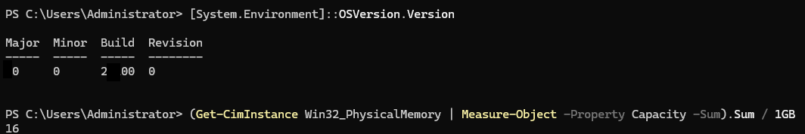

# Lab 01 — Check Host Requirements and Prepare Installation Media

## 1. Objective

Prepare the Windows host and installation media before creating the virtual machines for the practical IT Support lab.

By the end of this lab, the host requirements and installation media should be checked and ready for the next stage.

## 2. Lab Environment

- **Host operating system:** Windows 11 Pro
- **Virtualisation platform:** Hyper-V
- **Domain controller operating system:** Windows Server 2025 Standard Evaluation
- **Client operating system:** Windows 11 Pro

## 3. Prerequisites

- A Windows 11 Pro host computer
- Hyper-V installed and enabled
- Windows Server 2025 installation ISO
- Windows 11 installation ISO
- Sufficient available storage and memory for two virtual machines

## 4. Procedure

### Step 1 — Check the Host Operating System

1. Open **Settings**.
2. Navigate to **System → About**.
3. Check the Windows edition, processor, and installed RAM.
4. Confirm that the host meets the requirements for running the planned virtual machines.

### Step 2 — Verify Hyper-V Availability

1. Open **Start** and search for **Turn Windows features on or off**.
2. Confirm that Hyper-V is enabled.
3. Open Hyper-V Manager and verify that the host is available.

### Step 3 — Locate the Installation Media

Locate the following ISO files:

- Windows Server 2025 Standard Evaluation ISO
- Windows 11 installation ISO

Keep the files in a known folder so they can be selected when creating the virtual machines.

### Step 4 — Check Available Storage

1. Open File Explorer.
2. Check the free space on the drive that will store the virtual machine files.
3. Ensure that sufficient space is available for the virtual hard disks and installation media.

## 5. Validation Checklist

- [ ] Windows edition and installed memory have been checked.
- [ ] Hyper-V is enabled and the host is available in Hyper-V Manager.
- [ ] The Windows Server 2025 ISO is available.
- [ ] The Windows 11 ISO is available.
- [ ] Sufficient storage is available for the planned virtual machines.

## 6. Troubleshooting

**Hyper-V Manager is unavailable**

Check the Windows edition and Hyper-V feature status. Confirm that hardware virtualisation is enabled in the system firmware if required.

**An ISO file cannot be located**

Search the host computer for `.iso` files and confirm the file location before creating a virtual machine.

**Insufficient storage**

Review the planned virtual disk sizes and available drive space before proceeding. Avoid deleting files unless they have been identified as unnecessary.

## 7. Expected Outcome

The host is ready for the next lab, and both operating system installation images are available.

## 8. Evidence Record

Record the following information after completing the checks:

- Windows edition and host memory

*Figure 1: Checking the Windows edition, processor, and installed RAM on the host computer.*
- Hyper-V availability
- Installation ISO filenames and locations
- Available storage on the intended virtual machine drive

Screenshots may be added where they help demonstrate the configuration or verification result. Avoid including personal information.

## 9. Status

**Status:** Preparation confirmed; detailed host and storage checks remain to be documented.

## 10. Next Lab

[Lab 02 — Create an Isolated Hyper-V Virtual Switch](lab-02-hyperv-private-switch.md)
