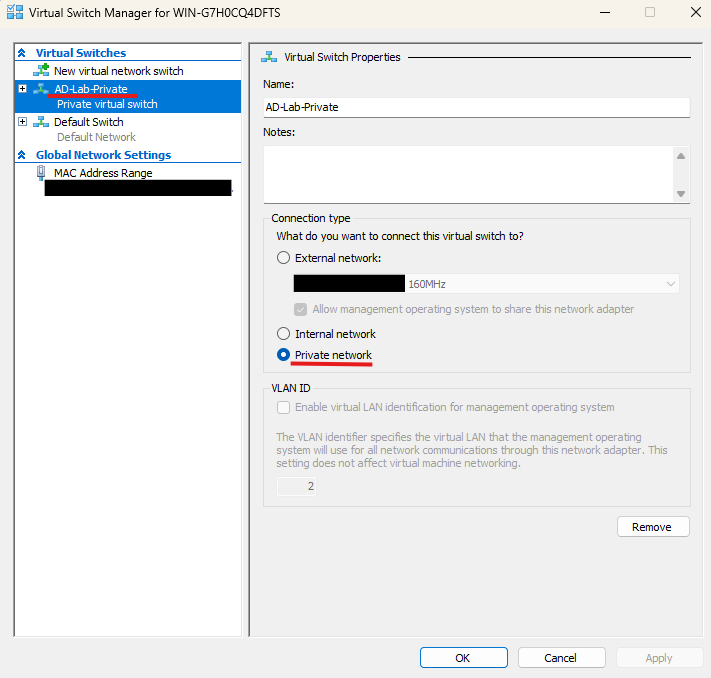
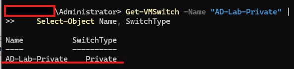

# Lab 02 — Create an Isolated Hyper-V Virtual Switch

## 1. Objective

Create and verify a private Hyper-V virtual switch to provide an isolated network for the Active Directory practice lab.

A **Private** virtual switch allows virtual machines connected to the same switch to communicate with each other. It does not provide direct connectivity to the host computer or external network through that switch.

## 2. Lab Environment

- **Host operating system:** Windows 11 Pro
- **Virtualisation platform:** Hyper-V
- **Virtual switch name:** `AD-Lab-Private`
- **Virtual switch type:** Private
- **Purpose:** Isolated networking for DC01 and CLIENT01

## 3. Prerequisites

- Windows 11 Pro host computer
- Hyper-V installed and enabled
- Hyper-V Manager available
- Administrator permissions to manage virtual switches

## 4. Procedure

### Step 1 — Open Virtual Switch Manager

1. Open **Hyper-V Manager**.
2. Select the host computer in the left panel.
3. Click **Virtual Switch Manager** in the Actions panel.

### Step 2 — Check the Existing Virtual Switch

1. Look for `AD-Lab-Private` in the list of virtual switches.
2. If it already exists, select it and verify that its type is **Private**.
3. If it does not exist, continue to Step 3.

### Step 3 — Create the Private Virtual Switch

Only perform this step if the switch does not already exist.

1. Under **Create virtual switch**, select **Private**.
2. Click **Create Virtual Switch**.
3. Enter the name `AD-Lab-Private`.
4. Add a description such as `Isolated network for the Active Directory lab`.
5. Click **Apply**, then **OK**.



### Step 4 — Verify the Switch Configuration

1. Open PowerShell as Administrator.
2. Run the following command:

```powershell
Get-VMSwitch -Name "AD-Lab-Private" |
    Select-Object Name, SwitchType
```

3. Check that the output shows:
   - Name: `AD-Lab-Private`
   - SwitchType: `Private`



### Step 5 — Connect the Virtual Machines

For each virtual machine that will use the isolated network:

1. Shut down the virtual machine if required.
2. Open its **Settings** in Hyper-V Manager.
3. Select **Network Adapter**.
4. Choose `AD-Lab-Private` from the virtual switch list.
5. Click **Apply** and **OK**.

Both DC01 and CLIENT01 should use the same private virtual switch for this lab.

## 5. Validation Checklist

- [x] `AD-Lab-Private` exists.
- [x] The switch type is `Private`.
- [ ] DC01 is connected to `AD-Lab-Private`.
- [ ] CLIENT01 is connected to `AD-Lab-Private`.
- [ ] Communication between the two VMs is tested in the relevant networking labs.

## 6. Troubleshooting

**The virtual switch already exists**

Check its name and type before creating another switch. Reuse the existing switch if its configuration is correct.

**The virtual machine has no network connectivity**

Check that its network adapter is connected to `AD-Lab-Private` and that the adapter is enabled inside the guest operating system.

**The VM cannot access the internet through this switch**

This is expected for a Private switch. It provides an isolated network between connected VMs, not direct internet access.

**The host cannot communicate with the VMs through this switch**

This is also expected for a Private switch. If host-to-VM communication is required, the network design needs to be reviewed rather than changing the switch type without considering the lab's isolation requirements.

## 7. Expected Outcome

The `AD-Lab-Private` virtual switch is available and configured as a Private switch. It provides the isolated network required for the Active Directory practice environment.

## 8. Status

**Status:** Switch created and verified as Private. VM adapter assignments should be confirmed and documented as part of the lab evidence.

## 9. Next Lab

[Lab 03 — Create and Install the Domain Controller VM](lab-03-domain-controller-vm.md)
