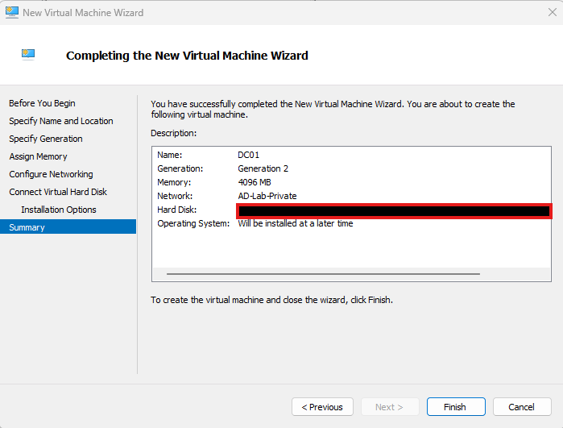
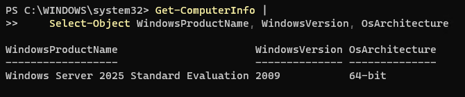
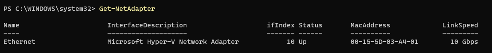

# Lab 03 — Create and Install the Domain Controller VM

## 1. Objective

Create a Hyper-V virtual machine named `DC01` and install Windows Server 2025 Standard Evaluation.

This virtual machine will later act as the domain controller for the `adlab.test` Active Directory lab.

## 2. Lab Environment

- **Host operating system:** Windows 11 Pro
- **Virtualisation platform:** Hyper-V
- **Virtual machine name:** DC01
- **Virtual machine generation:** Generation 2
- **Operating system:** Windows Server 2025 Standard Evaluation
- **Memory:** 4 GB, configured as dynamic memory
- **Virtual hard disk:** 60 GB VHDX
- **Virtual switch:** `AD-Lab-Private`
- **Domain name:** `adlab.test` (configured in a later lab)

## 3. Prerequisites

- Hyper-V is installed and enabled on the host.
- The Windows Server 2025 installation ISO is available.
- The `AD-Lab-Private` virtual switch has been created.
- Sufficient host memory and storage are available.

## 4. Procedure

### Step 1 — Open Hyper-V Manager

1. Sign in to the Windows 11 Pro host.
2. Open **Hyper-V Manager**.
3. Select the host computer in the left panel.
4. In the Actions panel, select **New → Virtual Machine**.

### Step 2 — Specify the Virtual Machine Name

1. In the New Virtual Machine Wizard, click **Next**.

2. Enter the virtual machine name:

   `DC01`

3. If you choose a custom location for the virtual machine files, ensure that the destination has sufficient storage.

4. Click **Next**.

### Step 3 — Select the Virtual Machine Generation

1. Select **Generation 2**.
2. Click **Next**.

Generation 2 supports modern virtual hardware and UEFI-based booting. The generation should be selected before the virtual machine is created.

### Step 4 — Configure Memory

1. Enter **4096 MB** as the startup memory.
2. Enable **Use Dynamic Memory for this virtual machine** if you intend to use dynamic memory.
3. Click **Next**.

Dynamic Memory allows Hyper-V to adjust the memory allocated to a supported virtual machine according to its memory requirements and the configured limits.

### Step 5 — Configure Networking

1. In the **Configure Networking** page, open the connection list.
2. Select `AD-Lab-Private`.
3. Click **Next**.

This connects DC01 to the isolated virtual network used by the Active Directory lab.

### Step 6 — Create the Virtual Hard Disk

1. Select **Create a virtual hard disk**.

2. Enter the disk name, for example:

   `DC01.vhdx`

3. Set the virtual hard disk size to **60 GB**.

4. Click **Next**.

A dynamically expanding VHDX can use less physical storage initially and grow as data is written, up to its configured maximum size.

### Step 7 — Select the Installation Media

1. Choose **Install an operating system from a bootable image file**.
2. Browse to the Windows Server 2025 ISO.
3. Select the ISO file.
4. Click **Next**, review the summary, and select **Finish**.

### Step 8 — Review the Virtual Machine Settings

1. In Hyper-V Manager, right-click `DC01`.
2. Select **Settings**.
3. Check that the memory, virtual hard disk, network adapter, and installation media are configured as intended.
4. Confirm that the network adapter uses `AD-Lab-Private`.

For a Generation 2 VM, review the Secure Boot configuration if the VM cannot boot from the installation media. Use a boot template appropriate for Windows Server.

### Step 9 — Start the Virtual Machine

1. Right-click `DC01`.
2. Select **Connect**.
3. In the Virtual Machine Connection window, click **Start**.
4. If prompted, press a key to boot from the DVD or ISO.

The Windows Server installation screen should appear.

### Step 10 — Install Windows Server

1. Select the appropriate language, time and currency format, and keyboard layout.
2. Click **Next**, then **Install now**.
3. If prompted to select an operating system edition, choose **Windows Server 2025 Standard Evaluation** with **Desktop Experience** if that is the intended graphical installation.
4. Accept the applicable licence terms.
5. Select **Custom: Install Microsoft Server Operating System only** when prompted for the installation type.
6. Select the virtual hard disk allocated to DC01.
7. Continue with the installation and wait for it to finish.

The installation will restart the virtual machine. Do not interrupt the installation while it is running.

### Step 11 — Set the Administrator Password

1. When prompted, set the local Administrator password.
2. Store the password securely.
3. Sign in to Windows Server using the local Administrator account.

The local Administrator account is used for initial server configuration. Domain accounts will be created after Active Directory Domain Services is installed.

### Step 12 — Verify the Installation

Open PowerShell inside DC01 and run:

```powershell
Get-ComputerInfo |
    Select-Object WindowsProductName, WindowsVersion, OsArchitecture
```

Then run:

```powershell
Get-NetAdapter
```

Confirm that Windows Server is installed and that a network adapter is present.

The network adapter may not yet have its final static IP configuration. That configuration is covered in Lab 04.

## 5. Validation Checklist

- [x] A virtual machine named `DC01` exists in Hyper-V Manager.
- [x] The VM uses Generation 2.
- [ ] Memory is configured as intended.
- [ ] A 60 GB VHDX is attached.
- [ ] The VM is connected to `AD-Lab-Private`.
- [ ] Windows Server 2025 Standard Evaluation is installed.
- [ ] The local Administrator can sign in.
- [ ] The operating system and network adapter have been checked.

## 6. Troubleshooting

**The VM does not boot from the ISO**

Check that the ISO is attached to the virtual DVD drive, that the boot order is appropriate, and that Secure Boot settings are compatible with the installation media.

**The VM has insufficient memory**

Check the host's available memory and the VM's startup memory and Dynamic Memory settings.

**The installation disk is not visible**

Review the virtual hard disk settings in Hyper-V Manager and confirm that the VHDX is attached to the VM.

**The VM has no network connectivity**

Confirm that the network adapter is connected to `AD-Lab-Private`. The static IP address and DNS configuration are handled in Lab 04.

## 7. Expected Outcome

A Generation 2 Hyper-V virtual machine named `DC01` runs Windows Server 2025 Standard Evaluation and is connected to the private lab network. It is ready for initial network configuration and the later installation of Active Directory Domain Services and DNS.

## 8. Status

**Status:** DC01 has been created and Windows Server 2025 Standard Evaluation has been installed. Review the checklist and add evidence for any configuration items that have not yet been documented.

## 10. Next Lab

[Lab 04 — Configure the Domain Controller's Network Settings](lab-04-domain-controller-network.md)
