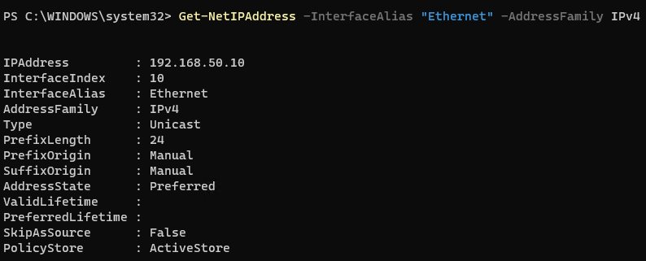
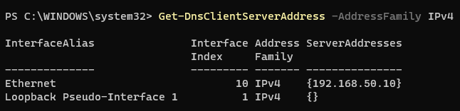

# Lab 04 — Configure the Domain Controller's Network Settings

## 1. Objective

Configure a static IPv4 address on the domain controller VM, DC01, and verify its network adapter and IP configuration.

A predictable IP address is important because client computers will use DC01 as their DNS server when locating Active Directory domain services.

## 2. Lab Environment

- **Virtual machine:** DC01
- **Operating system:** Windows Server 2025 Standard Evaluation
- **Virtual switch:** `AD-Lab-Private`
- **Network:** `192.168.50.0/24`
- **DC01 IPv4 address:** `192.168.50.10`
- **Subnet mask:** `255.255.255.0`
- **Default gateway:** Not configured
- **Preferred DNS server:** `192.168.50.10` after DNS is installed locally

## 3. Prerequisites

- DC01 has been created and Windows Server has been installed.
- DC01's network adapter is connected to `AD-Lab-Private`.
- You can sign in to DC01 using the local Administrator account.

## 4. Procedure

### Step 1 — Check the Network Adapter （already down last lab）

1. Sign in to DC01.
2. Open PowerShell as Administrator.
3. Run:

```powershell
Get-NetAdapter
```


4. Identify the active network adapter and its interface name.

In the commands below, the example interface name is `Ethernet`. If your adapter has a different name, replace `Ethernet` with the actual name shown by the command.

### Step 2 — Check the Current IP Configuration

Run:

```powershell
Get-NetIPConfiguration
```
Review the adapter's current IPv4 address, default gateway, and DNS configuration.

### Step 3 — Configure the Static IPv4 Address

First check whether the adapter already has the intended address:

```powershell
Get-NetIPAddress -InterfaceAlias "Ethernet" -AddressFamily IPv4
```

If `192.168.50.10` is already configured correctly, do not add it again.

If the address has not been configured, use the following command:

```powershell
New-NetIPAddress `
    -InterfaceAlias "Ethernet" `
    -IPAddress "192.168.50.10" `
    -PrefixLength 24
```

The `/24` prefix corresponds to the subnet mask `255.255.255.0`.

Before using this address, make sure it is not already assigned to another device on the lab network.

### Step 4 — Verify the IPv4 Address

Run:

```powershell
Get-NetIPAddress `
    -InterfaceAlias "Ethernet" `
    -AddressFamily IPv4
```

Confirm that the adapter has the address `192.168.50.10` with prefix length `24`.

### Step 5 — Check the Default Gateway

Run:

```powershell
Get-NetIPConfiguration
```

For this isolated lab network, a default gateway is not required for communication between DC01 and CLIENT01 on the same subnet.

Do not add a gateway unless the network design requires one.

### Step 6 — Configure DNS

The intended DNS configuration depends on whether the DNS Server role has already been installed.

**If DNS Server is already installed on DC01**, configure the adapter to use the local DNS server:

```powershell
Set-DnsClientServerAddress `
    -InterfaceAlias "Ethernet" `
    -ServerAddresses "127.0.0.1"
```

Loopback address `127.0.0.1` refers to DC01 itself. Using the server's own static address, `192.168.50.10`, is also possible.

**If DNS Server has not yet been installed**, complete the IP configuration first and configure DNS as part of the Active Directory and DNS setup in Lab 05.

### Step 7 — Verify the Final Configuration

Run:

```powershell
Get-NetIPConfiguration
```

Then run:

```powershell
Get-DnsClientServerAddress -AddressFamily IPv4
```

Verify that:

- The IPv4 address is `192.168.50.10`.
- The prefix length is `24`.
- No default gateway is configured for this isolated lab adapter.
- The DNS setting matches the current stage of the lab.

## 5. Validation Checklist

- [ ] DC01's intended static IPv4 address is `192.168.50.10/24`.
- [ ] The address and prefix length have been verified with PowerShell.
- [ ] The default gateway configuration has been checked.
- [ ] DNS has been configured according to the installation stage.
- [ ] The final command output has been saved as evidence.

## 6. Troubleshooting

**The adapter name does not match `Ethernet`**

Run `Get-NetAdapter` and use the actual interface name in the commands.

**The IP address is already in use**

Check the other devices on the isolated network before assigning the address. Do not create duplicate IP assignments.

**The IP configuration command reports an error**

Check the interface name, permissions, existing addresses, and whether the adapter is enabled.

**DNS resolution does not work**

Confirm that the DNS Server role is installed and running before testing DNS queries. Configuring the DNS client address alone does not install or start the DNS service.

## 7. Expected Outcome

DC01 has a predictable static IPv4 address on the isolated lab network. Its gateway and DNS settings are appropriate for the current setup stage, preparing the server for Active Directory and DNS configuration.

## 8. Evidence Record

Record the following:

- Output of `Get-NetAdapter`
- Output of `Get-NetIPConfiguration`
- Output of `Get-NetIPAddress`
- DNS client configuration, once applicable

Do not include passwords or unrelated personal information in screenshots.

## 9. Status

**Status:** The intended address is documented as `192.168.50.10/24`. Confirm the final command output before marking all validation items complete.

## 10. Next Lab

[Lab 05 — Install and Verify Active Directory Domain Services and DNS](lab-05-install-ad-ds-dns.md)
