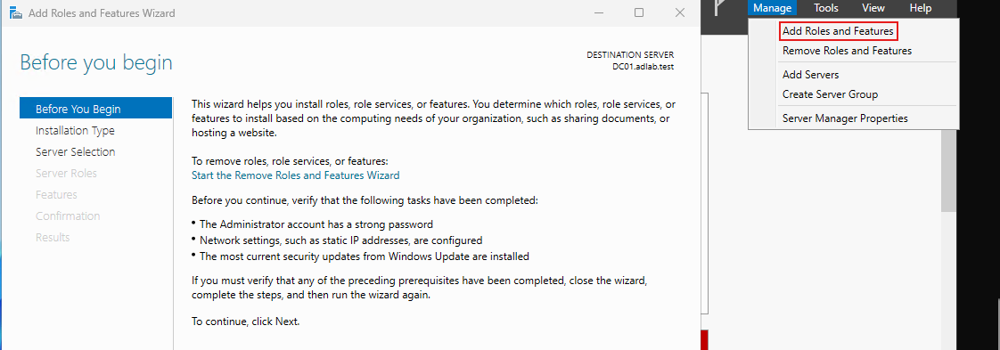
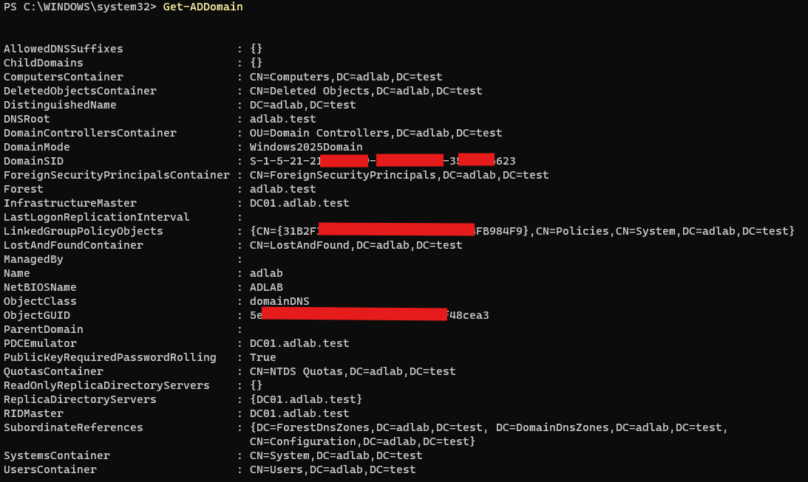
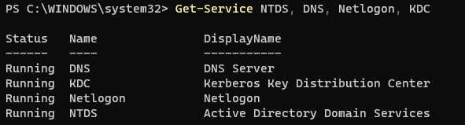
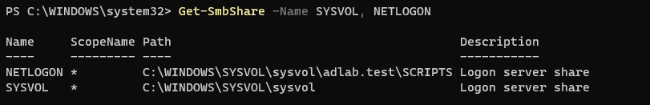
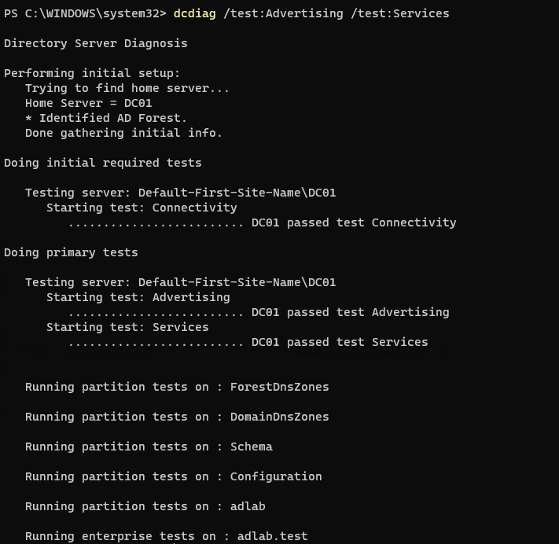
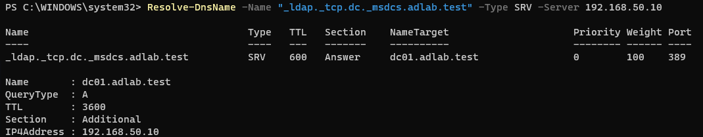

# Lab 05 — Install and Verify Active Directory Domain Services and DNS

## 1. Objective

Install the Active Directory Domain Services (AD DS) and DNS Server roles on DC01, promote the server to a domain controller, and verify that the domain services are working correctly.

## 2. Lab Environment

- **Virtual machine:** DC01
- **Operating system:** Windows Server 2025 Standard Evaluation
- **Server IPv4 address:** `192.168.50.10/24`
- **Domain name:** `adlab.test`
- **NetBIOS name:** `ADLAB`
- **Virtual switch:** `AD-Lab-Private`

## 3. Prerequisites

- DC01 has been created and Windows Server has been installed.
- You can sign in to DC01 using an account with local Administrator privileges.
- DC01 has the intended static IPv4 address, `192.168.50.10/24`.
- The domain name `adlab.test` is available for this isolated practice environment.

## 4. Procedure

### Step 1 — Check the Server Configuration

Open PowerShell as Administrator and run:

```powershell
Get-NetIPConfiguration
```

Confirm that DC01 uses `192.168.50.10` with the correct subnet prefix.

Check the DNS Server service before proceeding if the role may already have been installed:

```powershell
Get-Service DNS
```

If the service does not exist, the DNS Server role has not been installed or registered.

### Step 2 — Install the AD DS and DNS Roles

In Server Manager:

1. Select **Manage** → **Add Roles and Features**.
2. Select **Role-based or feature-based installation**.
3. Select DC01 as the destination server.
4. Select **Active Directory Domain Services**.
5. Accept the required features.
6. Select **DNS Server** and accept any required features.
7. Continue through the wizard and select **Install**.

Wait for installation to complete. Installing the roles alone does not yet make DC01 a domain controller.

### Step 3 — Promote DC01 to a Domain Controller

After the AD DS role is installed:

1. In Server Manager, select the notification flag.
2. Select **Promote this server to a domain controller**.
3. Choose **Add a new forest**.
4. Enter the root domain name:

   `adlab.test`

5. On the Domain Controller Options page, keep DNS Server selected.
6. Set a Directory Services Restore Mode (DSRM) password and store it securely.
7. Continue through the wizard.
8. Review the NetBIOS name and confirm it is `ADLAB`.
9. Continue through the prerequisite checks.
10. Select **Install** to begin promotion.

DC01 will restart automatically after promotion.

### Step 4 — Sign In and Verify the Domain

After the restart, sign in using the domain Administrator account. The sign-in may be shown as `ADLAB\Administrator` or `Administrator@adlab.test`.

Open PowerShell as Administrator and run:

```powershell
Get-ADDomain
```

Confirm that the domain information identifies `adlab.test`.

### Step 5 — Verify the Required Services

Run:

```powershell
Get-Service NTDS, DNS, Netlogon, KDC
```

Confirm that the services are running.

- **NTDS:** Active Directory Domain Services
- **DNS:** DNS Server
- **Netlogon:** Supports domain authentication and registration
- **KDC:** Kerberos Key Distribution Center

### Step 6 — Verify SYSVOL and NETLOGON Shares

Run:

```powershell
Get-SmbShare -Name SYSVOL, NETLOGON
```

Confirm that both shares are present.

These shares are important parts of a functioning Active Directory domain controller.

### Step 7 — Run Domain Controller Diagnostics

Run:

```powershell
dcdiag /test:Advertising /test:Services
```

Review the results and investigate any failed tests.

Then check the domain's DNS records:

```powershell
Resolve-DnsName -Name "_ldap._tcp.dc._msdcs.adlab.test" -Type SRV -Server 192.168.50.10
```

The query should return an SRV record identifying the domain controller's LDAP service.

## 5. Validation Checklist

- [ ] AD DS and DNS Server roles are installed.
- [ ] DC01 has been promoted to a domain controller.
- [ ] The domain is `adlab.test` and the NetBIOS name is `ADLAB`.
- [ ] The required services are running.
- [ ] SYSVOL and NETLOGON shares are present.
- [ ] Domain controller diagnostics complete successfully.
- [ ] The domain's LDAP SRV record resolves successfully.

## 6. Troubleshooting

**The promotion option is missing**

Confirm that the AD DS role installation completed successfully. Refresh Server Manager if necessary.

**The server cannot resolve domain DNS records**

Check that the DNS Server service is running and that the DNS zone and required SRV records exist.

**The server cannot complete domain controller diagnostics**

Review the failed test output. Check service status, DNS configuration, and the domain controller's network settings.

**The domain Administrator sign-in fails**

Confirm that you are using the domain Administrator account and the correct password. If necessary, verify whether Windows is showing the domain sign-in option rather than the local computer account.

## 7. Expected Outcome

DC01 is configured as the domain controller for `adlab.test`, with AD DS and DNS installed. The required services, SYSVOL and NETLOGON shares, domain controller diagnostics, and DNS records can be verified before proceeding to client VM setup.

## 8. Status

**Status:** AD DS, DNS, domain promotion, and verification should be marked complete only after the corresponding checks have been performed successfully.

## 9. Next Lab

[Lab 06 — Create and Install the Windows Client VM](lab-06-windows-client-vm.md)
