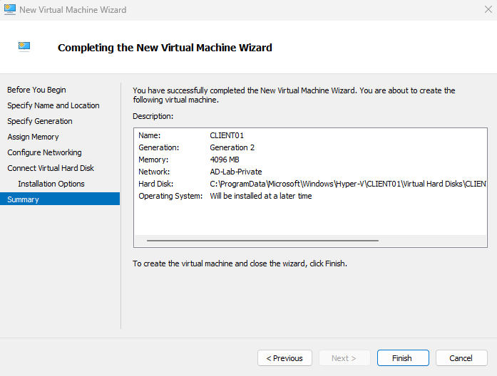
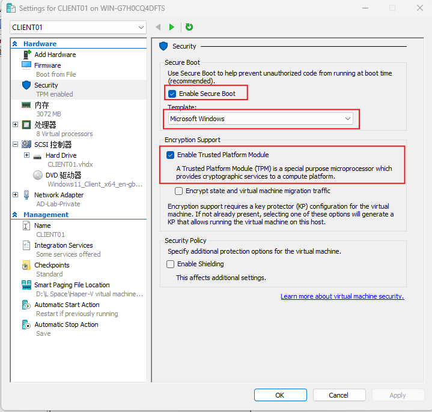
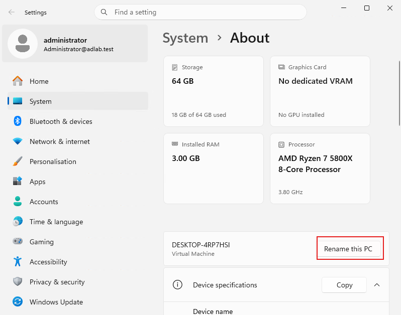
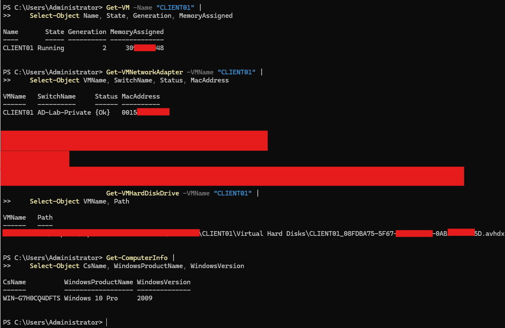

# Lab 06 — Create and Install the Windows Client VM

## 1. Objective

Create a Windows client virtual machine named `CLIENT01` in Hyper-V and install Windows 11 Pro.

This client VM will be used in later labs to practise network configuration, domain joining, domain user authentication, and file-share access.

## 2. Lab Environment

- **Host operating system:** Windows 11 Pro
- **Virtualisation platform:** Hyper-V
- **Virtual switch:** `AD-Lab-Private` (Private)
- **Domain controller:** `DC01`
- **Domain:** `adlab.test`
- **Client VM name:** `CLIENT01`
- **Client operating system:** Windows 11 Pro
- **Planned memory:** 4 GB
- **Planned virtual disk:** 60 GB
- **Planned IPv4 address:** `192.168.50.20/24`

## 3. Prerequisites

- Hyper-V is enabled on the host computer.
- The `AD-Lab-Private` virtual switch exists.
- DC01 has been created and Windows Server installed.
- A Windows 11 installation ISO is available.
- The Windows 11 edition and licence requirements have been checked.

**Important:** Windows 11 requires compatible virtual hardware, including a supported virtual TPM and Secure Boot configuration. Hyper-V Generation 2 supports these features. Do not disable security requirements simply to bypass an installation check.

## 4. Procedure

### Step 1 — Open Hyper-V Manager

1. Sign in to the Windows 11 host.
2. Open **Hyper-V Manager**.
3. Confirm that the local Hyper-V host is listed.
4. Check that `DC01` exists in the virtual machine list.

### Step 2 — Create the CLIENT01 Virtual Machine

1. In Hyper-V Manager, select **New** → **Virtual Machine**.
2. Select **Next** on the introduction page.
3. Enter the virtual machine name:

   `CLIENT01`

4. Select a storage location if you do not want to use the default location.
5. Select **Generation 2**.
6. Assign **4096 MB (4 GB)** of startup memory.
7. Enable **Dynamic Memory** if appropriate for your host's available resources.
8. On the networking page, select:

   `AD-Lab-Private`

9. Create a new virtual hard disk:
   - Name: `CLIENT01.vhdx`
   - Size: `60 GB`
10. Select the option to install an operating system from a bootable image file.
11. Browse to the Windows 11 ISO.
12. Review the settings and select **Finish**.

### Step 3 — Configure Windows 11 Virtual Hardware

Before starting the VM:

1. Right-click `CLIENT01` and select **Settings**.
2. Select **Security**.
3. Confirm that Secure Boot is enabled.
4. Configure the Secure Boot template for Windows if required.
5. Enable the virtual Trusted Platform Module (TPM) if the option is available.
6. Confirm that the network adapter is connected to `AD-Lab-Private`.
7. Select **Apply**, then **OK**.


If Hyper-V requires a key protector or additional security configuration to enable the TPM, follow the available Hyper-V interface prompts. Do not change DC01's settings while configuring CLIENT01.

### Step 4 — Install Windows 11

1. Select `CLIENT01` in Hyper-V Manager.
2. Select **Connect**.
3. Select **Start** in the Virtual Machine Connection window.
4. Boot from the Windows 11 ISO.
5. Select the installation language, time format, and keyboard layout.
6. Select **Install now**.
7. Follow the installation prompts.
8. Select Windows 11 Pro if the installer asks you to choose an edition and that edition is available under your installation media and licence.
9. Accept the applicable licence terms.
10. Select the custom installation option when asked for the installation type.
11. Select the unallocated space on the virtual disk and continue.
12. Wait for Windows installation and the initial setup to finish.

Do not delete or modify the host computer's physical partitions. All installation work should take place inside the CLIENT01 VM.

### Step 5 — Complete Initial Windows Setup

1. Complete the Windows 11 first-run setup.
2. Create or configure an initial local account according to the available setup options.
3. Sign in to Windows.
4. Open **Settings** → **System** → **About**.
5. Confirm the Windows edition and device name.
6. If necessary, rename the computer to `CLIENT01` and restart it.

If the initial setup requires an internet connection or a Microsoft account, follow the legitimate setup options available for your Windows 11 edition. Do not assume every installer provides the same offline setup options.

### Step 6 — Verify the Virtual Machine

On the host, open PowerShell and run:

```powershell
Get-VM -Name "CLIENT01" |
    Select-Object Name, State, Generation, MemoryAssigned
```

Check the virtual network adapter:

```powershell
Get-VMNetworkAdapter -VMName "CLIENT01" |
    Select-Object VMName, SwitchName, Status, MacAddress
```

Check the virtual disk:

```powershell
Get-VMHardDiskDrive -VMName "CLIENT01" |
    Select-Object VMName, Path
```

Inside CLIENT01, open PowerShell and run:

```powershell
Get-ComputerInfo |
    Select-Object CsName, WindowsProductName, WindowsVersion
```

Then check the network adapter:

```powershell
Get-NetAdapter
```

At this stage, the client may not yet have its final static IP address. That configuration will be completed in Lab 07.

## 5. Validation Checklist

- [ ] A virtual machine named `CLIENT01` exists.
- [ ] The VM uses Generation 2.
- [ ] Startup memory is configured as intended.
- [ ] A 60 GB virtual disk is attached.
- [ ] The VM is connected to `AD-Lab-Private`.
- [ ] Secure Boot is enabled.
- [ ] A virtual TPM is enabled.
- [ ] Windows 11 Pro is installed.
- [ ] You can sign in to Windows.
- [ ] The computer name is `CLIENT01`.
- [ ] The virtual network adapter is detected.

## 6. Troubleshooting

**The Windows 11 installer reports that the PC does not meet requirements**

Check that the VM uses Generation 2 and that Secure Boot and virtual TPM are configured correctly. Also verify the installation media and virtual hardware settings.

**The VM does not boot from the ISO**

Confirm that the ISO is attached to the virtual DVD drive and check the VM's boot order.

**The VM has no network connectivity**

Confirm that its network adapter is connected to `AD-Lab-Private`. Internet access is not required for communication with another VM on the same private virtual switch.

**The virtual machine runs slowly**

Check the host's available memory and CPU resources. Avoid allocating more memory than the host can reasonably provide.

**Windows setup requests an account or network connection**

The available setup flow can vary by Windows edition and installation media. Follow the supported setup options rather than assuming every version has the same screens.

## 7. Expected Outcome

A Windows 11 client VM named `CLIENT01` is installed in Hyper-V and connected to `AD-Lab-Private`. The VM is ready for network configuration and domain connectivity testing in the next lab.

## 8. Status

**Status:** Complete the installation and verification steps before marking Lab 06 as finished.

## 9. Next Lab

[Lab 07 — Configure and Verify Client Networking](lab-07-client-networking.md)
