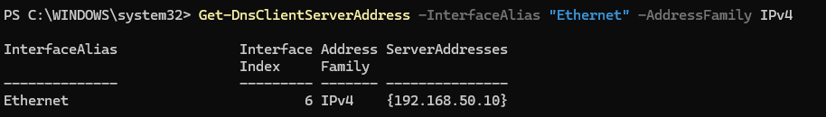
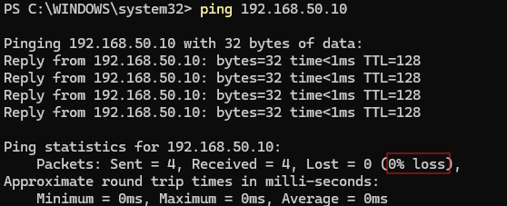
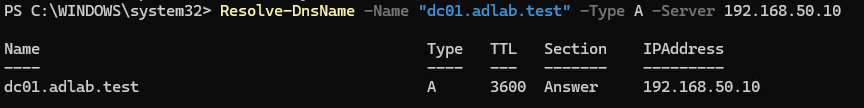
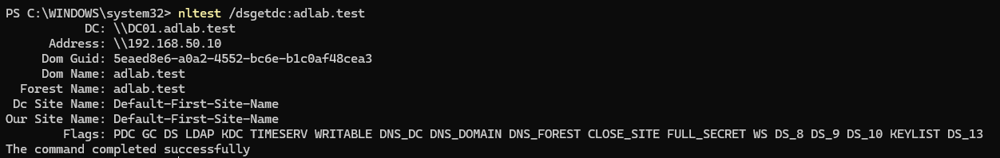

# Lab 07 — Configure and Verify Client Networking

## 1. Objective

Configure and verify the Windows client VM's IPv4 settings, DNS configuration, and network connectivity to the domain controller.

The goal is to confirm that CLIENT01 can communicate with DC01 and resolve the DNS records required for the `adlab.test` domain.

## 2. Lab Environment

- **Client VM:** CLIENT01
- **Client OS:** Windows 11 Pro
- **Domain controller:** DC01
- **Domain:** `adlab.test`
- **Virtual switch:** `AD-Lab-Private` (Private)
- **Client IPv4 address:** `192.168.50.20`
- **Domain controller IPv4 address:** `192.168.50.10`
- **Subnet prefix:** `/24`
- **Preferred DNS server:** `192.168.50.10`
- **Default gateway:** Not configured

## 3. Prerequisites

- CLIENT01 and DC01 have been created.
- Both virtual machines are connected to `AD-Lab-Private`.
- DC01 is running.
- AD DS and DNS have been installed on DC01.
- You can sign in to CLIENT01 with an account that has permission to inspect or configure network settings.

## 4. Procedure

### Step 1 — Check the Network Adapter

On CLIENT01, open PowerShell. Administrator privileges are needed if you later change network settings.

Run:

```powershell
Get-NetAdapter
```

Review the following fields:

- `Name`: network interface name, expected to be `Ethernet`.
- `InterfaceDescription`: should identify the Microsoft Hyper-V Network Adapter.
- `Status`: should be `Up`.
- `LinkSpeed`: shows the reported link speed.

A status of `Up` means the virtual network adapter is operational at the link level. It does not, by itself, prove that IP connectivity or DNS works.

### Step 2 — Inspect the Current IP Configuration

Run:

```powershell
Get-NetIPConfiguration
```

Then run:

```powershell
Get-NetIPAddress -InterfaceAlias "Ethernet" -AddressFamily IPv4
```

Review the output and confirm that CLIENT01 has the intended IPv4 address and prefix length.

Expected configuration:

| Setting | Expected value |
|---|---|
| IPv4 address | `192.168.50.20` |
| Prefix length | `24` |
| Subnet mask | `255.255.255.0` |
| Default gateway | Not configured |
| DNS server | `192.168.50.10` |

If the existing configuration matches these values, do not add the address again.

### Step 3 — Configure a Static IPv4 Address if Required

**Skip this step if CLIENT01 already has the correct static address.**

Before making changes, inspect the current addresses and check that `192.168.50.20` is not assigned to another device.

If the intended address is missing and you have confirmed it is available, open PowerShell as Administrator and run:

```powershell
New-NetIPAddress `
    -InterfaceAlias "Ethernet" `
    -IPAddress "192.168.50.20" `
    -PrefixLength 24
```

This command adds the IPv4 address to the interface. It does not configure the DNS server.

If Windows reports that the address already exists, stop and inspect the current configuration rather than repeatedly running the command.

### Step 4 — Configure the DNS Server if Required

**Skip this step if DNS is already set to `192.168.50.10`.**

Inspect the DNS configuration:

```powershell
Get-DnsClientServerAddress -InterfaceAlias "Ethernet" -AddressFamily IPv4
```

If the DNS address is incorrect and you have confirmed that DC01's DNS service is available, open PowerShell as Administrator and run:

```powershell
Set-DnsClientServerAddress `
    -InterfaceAlias "Ethernet" `
    -ServerAddresses "192.168.50.10"
```

Verify the result:

```powershell
Get-DnsClientServerAddress -InterfaceAlias "Ethernet" -AddressFamily IPv4
```

CLIENT01 must use the lab's domain DNS server to locate Active Directory services. Do not replace it with a public DNS server for this domain lab.

### Step 5 — Test Connectivity to DC01

Run:

```powershell
ping 192.168.50.10
```

A successful result should show replies from `192.168.50.10` and ideally zero packet loss.

If Ping fails, do not immediately change the IP address. Check that DC01 is running, both VMs are connected to the same private virtual switch, and both addresses are in the intended subnet.

Note that a failed Ping alone does not prove the server is unreachable; firewall rules can block ICMP.

### Step 6 — Test DNS Name Resolution

First test the domain controller's hostname:

```powershell
Resolve-DnsName -Name "dc01.adlab.test" -Type A -Server 192.168.50.10
```

The expected A record points to:

`192.168.50.10`

Then test the Active Directory LDAP SRV record:

```powershell
Resolve-DnsName `
    -Name "_ldap._tcp.dc._msdcs.adlab.test" `
    -Type SRV `
    -Server 192.168.50.10
```

The result should identify `dc01.adlab.test` as the service target and show LDAP port `389`.

An A record resolves a hostname to an IP address. An SRV record identifies a service endpoint, which Active Directory clients use to locate domain services.

### Step 7 — Check Domain Controller Discovery

Run:

```powershell
nltest /dsgetdc:adlab.test
```

If discovery succeeds, the output should identify DC01 and its domain information.

This test checks whether the client can discover a domain controller. It is a useful additional check before attempting to join the domain.

### Step 8 — Record the Validation Results

Review the actual output from each command.

A successful network validation should establish that:

- The client network adapter is up.
- The client has the intended IPv4 address and DNS server.
- The client can reach DC01 by IP.
- The client can resolve DC01's hostname.
- The Active Directory LDAP SRV record resolves.
- Domain controller discovery succeeds, if tested.

Do not record a test as successful unless you have run it and confirmed its result.

## 5. Validation Checklist

- [ ] The Ethernet adapter is up.
- [ ] CLIENT01 has IPv4 address `192.168.50.20/24`.
- [ ] The default gateway is not configured for this isolated lab network.
- [ ] DNS points to `192.168.50.10`.
- [ ] Ping to DC01 succeeds.
- [ ] `dc01.adlab.test` resolves to `192.168.50.10`.
- [ ] The LDAP SRV record resolves successfully.
- [ ] `nltest /dsgetdc:adlab.test` discovers DC01.

## 6. Troubleshooting

**The network adapter is disconnected or disabled**

Check the adapter status with `Get-NetAdapter`. Then verify the VM's virtual network adapter settings in Hyper-V Manager on the host.

**The client has an unexpected IP address**

Inspect `Get-NetIPConfiguration` and `Get-NetIPAddress`. Check for duplicate addresses before changing the configuration.

**Ping to DC01 fails**

Confirm DC01 is running, both VMs use `AD-Lab-Private`, and the IPv4 addresses and subnet prefixes are correct. Consider firewall behaviour before concluding that the network is broken.

**The hostname resolves but the LDAP SRV query fails**

Check that the DNS Server service is running on DC01 and that the Active Directory DNS SRV records exist.

**DNS queries fail against `192.168.50.10`**

Verify the client's DNS setting, then check DC01's DNS service and network connectivity.

**Domain controller discovery fails**

Check DNS first, especially the LDAP SRV record under `_msdcs.adlab.test`. Also confirm DC01 is running and the domain name is correct.

## 7. Expected Outcome

CLIENT01 has a verified IPv4 configuration and uses DC01 as its DNS server. Connectivity to DC01 and the DNS records needed for Active Directory can be tested successfully.

These results prepare the client for the domain-joining procedure in Lab 08.

## 8. Status

**Status:** Record the lab as complete after the relevant network, DNS, and domain controller discovery tests have been run and verified.

## 9. Next Lab

[Lab 08 — Join the Client to the Domain](lab-08-join-client-to-domain.md)
