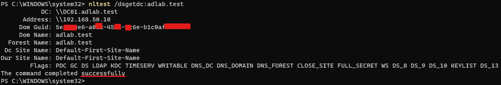
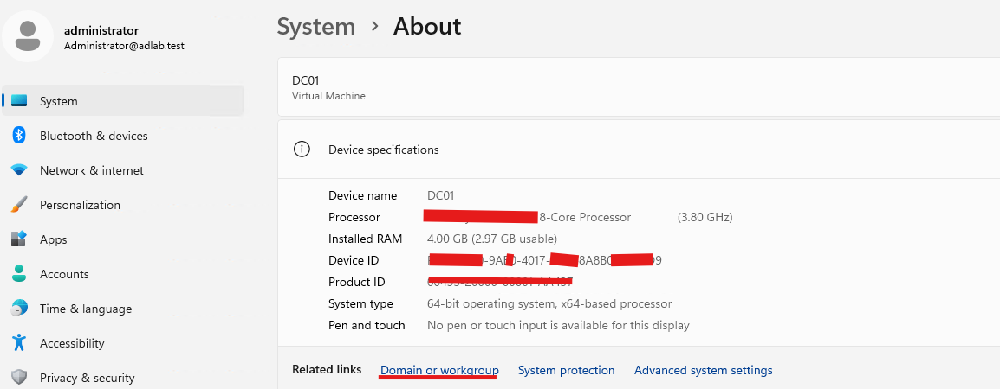

# Lab 08 — Join the Client to the Domain

## 1. Objective

Join the Windows client computer `CLIENT01` to the Active Directory domain `adlab.test` and verify that the computer can authenticate with the domain.

## 2. Lab Environment

| Item | Configuration |
|---|---|
| Domain Controller | `DC01` |
| Client Computer | `CLIENT01` |
| Domain Name | `adlab.test` |
| NetBIOS Domain Name | `ADLAB` |
| DC01 IPv4 Address | `192.168.50.10` |
| CLIENT01 IPv4 Address | `192.168.50.20` |
| CLIENT01 DNS Server | `192.168.50.10` |
| Virtual Switch | `AD-Lab-Private` |

## 3. Prerequisites

Before starting, confirm:

- [ ] DC01 is running.
- [ ] Active Directory Domain Services and DNS are running on DC01.
- [ ] CLIENT01 can communicate with DC01.
- [ ] CLIENT01 uses `192.168.50.10` as its DNS server.
- [ ] You have valid domain credentials with permission to join computers to the domain.

**Important:** Run client-side commands on `CLIENT01`, not on DC01 or the Hyper-V host.

## 4. Procedure

### Step 1 — Check the current computer and domain status

On CLIENT01, open PowerShell.

Run:

```powershell
Get-CimInstance Win32_ComputerSystem |
    Select-Object Name, Domain, PartOfDomain
```

Interpret the results:

- `Name` should be `CLIENT01`.
- If `PartOfDomain` is `False`, the computer is not currently domain-joined.
- If `PartOfDomain` is `True` and `Domain` is `adlab.test`, the computer is already joined. Do not join it again; continue to Step 6 to verify the configuration.

### Step 2 — Verify DNS resolution

Run:

```powershell
Resolve-DnsName -Name "dc01.adlab.test" -Type A -Server 192.168.50.10
```

Expected result: `dc01.adlab.test` resolves to `192.168.50.10`.

Next, check the domain controller discovery record:

```powershell
Resolve-DnsName -Name "_ldap._tcp.dc._msdcs.adlab.test" -Type SRV -Server 192.168.50.10
```

Expected result: an SRV record identifies `dc01.adlab.test` as an LDAP domain controller, using port `389`.

If either query fails, stop and troubleshoot DNS before attempting the domain join.

### Step 3 — Discover the domain controller

Run:

```powershell
nltest /dsgetdc:adlab.test
```

Expected result: the command identifies a domain controller for `adlab.test`, normally `DC01`.

If the command cannot find a domain controller, check the client DNS configuration and confirm that DC01 is running.

### Step 4 — Join CLIENT01 to the domain

First, make sure you have saved any open work. The computer will restart after a successful join.

On CLIENT01, open PowerShell **as Administrator** and run:

```powershell
Add-Computer -DomainName "adlab.test" -Credential (Get-Credential) -Restart
```

When the credential prompt appears, enter a domain account authorised to join computers to the domain. For example, if you are using the domain Administrator account, enter:

`ADLAB\Administrator`

Enter the actual password for that account in the secure prompt. Do not put the password directly into the PowerShell command or record it in your portfolio.

If the command succeeds, CLIENT01 will restart automatically.

**Alternative — use the Windows interface**

1. Open **Settings**.
2. Navigate to **System → About**.
3. Open **Domain or workgroup** or the available advanced system settings for renaming or joining a domain. The exact wording can vary by Windows build.
4. Select the option to join a domain.
5. Enter `adlab.test`.
6. Provide authorised domain credentials when prompted.
7. Accept the confirmation and restart CLIENT01.

Use either the PowerShell method or the Windows interface, not both.

### Step 5 — Sign in using a domain account

After CLIENT01 restarts:

1. At the Windows sign-in screen, choose **Other user** if necessary.
2. Enter a valid domain user account in one of these formats:

   - `ADLAB\username`
   - `username@adlab.test`

3. Enter that user's domain password.

Use an existing valid domain account. If you have not created a separate test user yet, use an authorised account available in your lab.

A successful sign-in helps confirm that CLIENT01 can reach the domain and authenticate the user.

### Step 6 — Verify the domain join

After signing in, open PowerShell on CLIENT01.

Run:

```powershell
Get-CimInstance Win32_ComputerSystem |
    Select-Object Name, Domain, PartOfDomain
```

Expected result:

- `Name`: `CLIENT01`
- `Domain`: `adlab.test`
- `PartOfDomain`: `True`

Next, run:

```powershell
Test-ComputerSecureChannel -Verbose
```

Expected result:

`True`

This checks whether the computer's secure channel to the domain is working. If it returns `False` or an error, investigate before attempting repairs.

Finally, run:

```powershell
nltest /sc_verify:adlab.test
```

A successful result indicates that the secure channel verification passed. If this command reports an error, record the exact message and investigate it rather than assuming the join is fully healthy.

## 5. Validation Checklist

Mark each item only after you have observed the result.

- [ ] CLIENT01 was confirmed to be either not domain-joined or already joined.
- [ ] `dc01.adlab.test` resolved to `192.168.50.10`.
- [ ] The LDAP SRV query returned the domain controller record.
- [ ] `nltest /dsgetdc:adlab.test` discovered a domain controller.
- [ ] CLIENT01 joined `adlab.test` successfully, or its existing join was verified.
- [ ] CLIENT01 restarted after a new domain join.
- [ ] A valid domain account successfully signed in.
- [ ] `PartOfDomain` returned `True`.
- [ ] `Test-ComputerSecureChannel` returned `True`.
- [ ] Secure-channel verification completed successfully.

## 6. Troubleshooting

### Problem A — The domain cannot be found

**Possible cause:** CLIENT01 is using the wrong DNS server, or AD DNS records cannot be resolved.

Check:

```powershell
Get-DnsClientServerAddress -InterfaceAlias "Ethernet" -AddressFamily IPv4
```

The configured DNS server should be `192.168.50.10`.

Then rerun the A-record and SRV-record queries from Steps 2 and 3.

### Problem B — Access is denied or credentials are rejected

**Possible causes:**

- The password or account name is incorrect.
- The account is not authorised to join computers to the domain.
- The account is locked or disabled.

Confirm the account and password, and use an authorised domain account. Do not repeatedly guess passwords.

### Problem C — The computer name already exists in the domain

A previous attempt may have created a computer account for `CLIENT01`.

On DC01, an administrator can open **Active Directory Users and Computers** and search for the `CLIENT01` computer account.

Do not delete or reset the account automatically. First confirm whether it is the intended lab computer and whether an existing domain relationship needs to be preserved.

### Problem D — Domain join succeeds, but domain sign-in fails

Check that:

- CLIENT01 is connected to the private lab network.
- DC01 is running.
- CLIENT01 is still using `192.168.50.10` for DNS.
- The domain user exists and is enabled.
- The credentials are entered using `ADLAB\username` or `username@adlab.test`.

A successful domain join does not prove that every user account is valid.

### Problem E — Secure-channel verification fails

First confirm that CLIENT01 can resolve and reach DC01 and that the system clocks are reasonably synchronised.

Do not immediately run commands that reset the computer password or repair the secure channel. Record the error and investigate the cause first.

## 7. Expected Outcome

CLIENT01 is a member of `adlab.test`, a valid domain user can sign in, and the computer's secure channel verifies successfully.

If CLIENT01 was already joined before this lab, document the existing status and verification results instead of repeating the join.

## 8. Status

**Status:** In Progress

Update this status after completing the procedure and validation checklist.

## 9. Next Lab

[Lab 09 — Create Test Users, Groups, and Organisational Units](lab-09-create-users-groups-ous.md)
