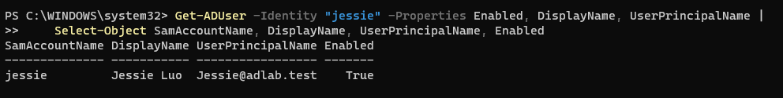
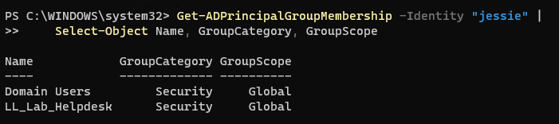
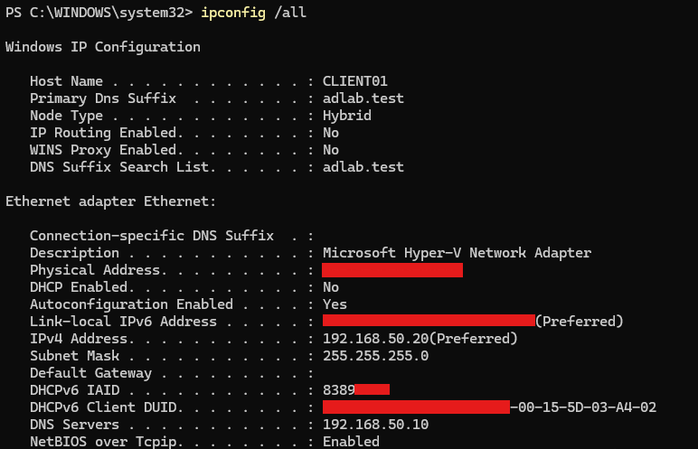
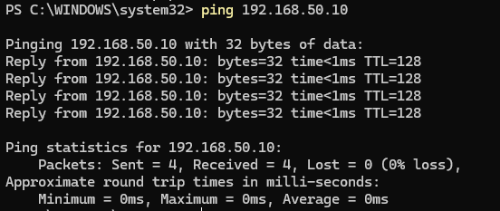
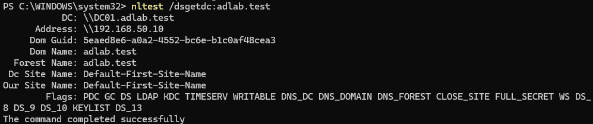
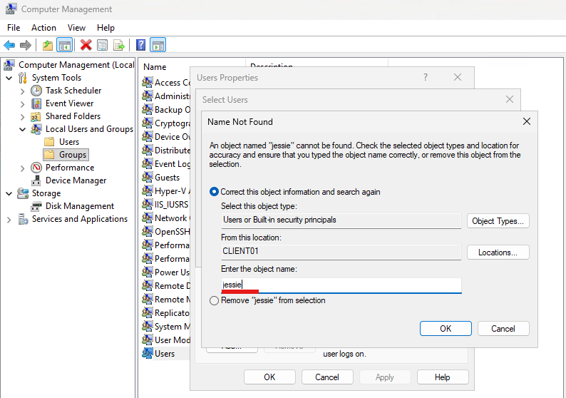
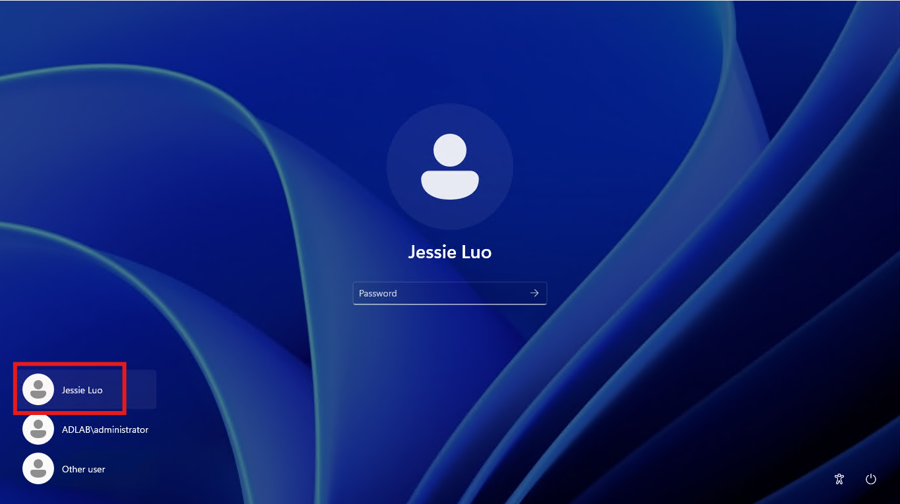

# Lab 10 — Configure and Verify Domain User Access on CLIENT01

## 1. Objective

Configure `CLIENT01` to allow the existing Active Directory user `jessie` to sign in, then verify the user's domain identity and security-group membership.

This lab builds based on Lab 09. It does not recreate the user, security group, or domain-joined client computer.

## 2. Lab Environment

| Item | Configuration |
|---|---|
| Domain Controller | `DC01` |
| Domain Name | `adlab.test` |
| NetBIOS Domain Name | `ADLAB` |
| Client Computer | `CLIENT01` |
| Domain Controller IP | `192.168.50.10` |
| Client IP | `192.168.50.20` |
| Hyper-V Virtual Switch | `AD-Lab-Private` |
| User OU | `OU=Lab-Users,DC=adlab,DC=test` |
| Group OU | `OU=Lab-Groups,DC=adlab,DC=test` |
| Test User | `jessie` |
| Display Name | `Jessie Luo` |
| Security Group | `LL_Lab_Helpdesk` |

## 3. Prerequisites

Before starting, confirm:

- [ ] `DC01` is running.
- [ ] The `adlab.test` domain is operational.
- [ ] `CLIENT01` has already joined the domain.
- [ ] `CLIENT01` can communicate with `DC01`.
- [ ] The `jessie` account exists and is enabled.
- [ ] `jessie` belongs to `LL_Lab_Helpdesk`.
- [ ] You know the password for the existing `jessie` account.
- [ ] You can sign in to `CLIENT01` with an account that has local administrator rights, if local group membership needs to be configured.

**Important:** Run Active Directory checks on `DC01`. Configure client-side local group membership on `CLIENT01`. Do not create another `jessie` account, and do not store the account password in this document or in GitHub.

## 4. Procedure

### Step 1 — Verify the existing user and group on DC01

On `DC01`, open PowerShell as Administrator.

Check the user:

```powershell
Get-ADUser -Identity "jessie" -Properties Enabled, DisplayName, UserPrincipalName |
    Select-Object SamAccountName, DisplayName, UserPrincipalName, Enabled
```



Expected result:

- `SamAccountName`: `jessie`
- `DisplayName`: `Jessie Luo`
- `Enabled`: `True`

Check group membership:

```powershell
Get-ADPrincipalGroupMembership -Identity "jessie" |
    Select-Object Name, GroupCategory, GroupScope
```



Expected result includes `Domain Users` and `LL_Lab_Helpdesk`.

If the user is missing or disabled, resolve that issue before continuing. Do not create a duplicate account.

### Step 2 — Confirm CLIENT01 can locate the domain

Sign in to `CLIENT01` using an existing account.

Check the computer name:

```powershell
hostname
```


Expected result: `CLIENT01`.

Check the network configuration:

```powershell
ipconfig /all
```



Confirm that the lab network uses client IP `192.168.50.20` and DNS server `192.168.50.10`.

Test connectivity:

```powershell
ping 192.168.50.10
```



Then check domain discovery:

```powershell
nltest /dsgetdc:adlab.test
```



Expected result: a domain controller for `adlab.test` is found, normally `DC01`.

If domain discovery fails, troubleshoot the VM network and DNS configuration before proceeding. A failed ping alone does not prove that the domain is unavailable because ICMP may be blocked.

### Step 3 — Configure CLIENT01 for domain-user sign-in

Sign in to `CLIENT01` using an account with local administrator rights.

1. Right-click **Start** and open **Computer Management**.
2. Navigate to **Local Users and Groups → Groups → Users**.
3. Open the local `Users` group and inspect its members.
4. If `ADLAB\jessie` is already listed, leave it unchanged and continue to Step 4.
5. If it is not listed, select **Add**.
6. Select **Locations** and choose the `adlab.test` domain.
7. Enter `jessie`, then select **Check Names**.
8. Confirm that Windows resolves the account to `ADLAB\jessie`.
9. Select **OK**, then **Apply**.



Verify membership in PowerShell:

```powershell
Get-LocalGroupMember -Group "Users"
```

Expected result: `ADLAB\jessie` appears if you added the user directly.

If the domain cannot be selected or Windows cannot resolve the user, stop and investigate domain connectivity. Do not create a local account named `jessie` as a workaround.

**Security note:** The local `Users` group provides ordinary user access, not administrator rights. Do not add `jessie` to `Administrators` for this lab. If the organisation or lab uses a different sign-in policy, follow that policy rather than changing permissions unnecessarily.

### Step 4 — Sign in to CLIENT01 as the domain user

On `CLIENT01`, sign out of the current Windows session.

At the Windows sign-in screen:

1. Select **Other user**, if needed.
2. Enter the username `ADLAB\jessie`.
3. Enter the password for the existing domain account.
4. Select **Sign in**.



Do not enter `.\jessie`: that format refers to a local account on `CLIENT01`.

Expected result: Windows opens a desktop session for the domain user.

If sign-in fails, check the username format, account status, password, network connectivity, and local sign-in permissions.

### Step 5 — Verify the signed-in identity

Open Command Prompt or PowerShell on `CLIENT01`.

Run:

```powershell
whoami
```


Expected result:

```text
adlab\jessie
```

Check the computer name:

```powershell
hostname
```

Expected result:

```text
CLIENT01
```

If `whoami` shows another account, sign out and sign in again using `ADLAB\jessie`.

### Step 6 — Verify the user's security-group token

While signed in as `ADLAB\jessie`, run:

```powershell
whoami /groups
```


Check whether `LL_Lab_Helpdesk` appears in the output.

If the user was added to the group after the current session started, sign out and sign in again before checking. Windows creates the user's access token at sign-in.

Membership in `LL_Lab_Helpdesk` does not automatically grant administrator rights or access to every resource. The group must be assigned the relevant permissions separately.

### Step 7 — Record the verification results

| Check | Expected result | Actual result |
|---|---|---|
| `hostname` | `CLIENT01` | |
| `whoami` | `adlab\jessie` | |
| `whoami /groups` | Includes `LL_Lab_Helpdesk` | |
| Domain discovery | Finds a DC for `adlab.test` | |
| Domain-user sign-in | Successful | |

Record the actual results rather than marking the checks successful based only on the expected output.

## 5. Validation Checklist

Mark each item only after checking the actual result.

- [ ] Confirmed that `jessie` exists and is enabled on `DC01`.
- [ ] Confirmed that `jessie` belongs to `LL_Lab_Helpdesk`.
- [ ] Confirmed that `CLIENT01` has the expected lab network configuration.
- [ ] Confirmed that `CLIENT01` can locate a domain controller for `adlab.test`.
- [ ] Checked whether `ADLAB\jessie` can sign in under the client's current local sign-in permissions.
- [ ] Added `ADLAB\jessie` to the local `Users` group only if necessary and permitted by the lab policy.
- [ ] Signed in to `CLIENT01` using `ADLAB\jessie`.
- [ ] Confirmed that `whoami` returns `adlab\jessie`.
- [ ] Confirmed that `whoami /groups` includes `LL_Lab_Helpdesk`.
- [ ] Recorded the actual verification results.
- [ ] Confirmed that no duplicate user or group was created.

## 6. Troubleshooting

### Problem A — The domain controller cannot be located

**Possible causes:** Incorrect DNS settings, incorrect IP configuration, or a VM network-adapter problem.

Check:

```powershell
ipconfig /all
```

On `CLIENT01`, confirm that the DNS server for the lab network is `192.168.50.10`.

Retry:

```powershell
nltest /dsgetdc:adlab.test
```

Do not use a public DNS server as the client's only DNS server for this isolated AD lab. Active Directory domain discovery depends on the domain's DNS records.

### Problem B — Windows rejects the domain username or password

Enter the username as `ADLAB\jessie`.

On `DC01`, verify the account status:

```powershell
Get-ADUser -Identity "jessie" -Properties Enabled, LockedOut |
    Select-Object SamAccountName, Enabled, LockedOut
```

If the account is disabled or locked, resolve that condition using an authorised administrative account. Do not repeatedly guess passwords or put passwords in command history.

### Problem C — Windows cannot resolve `ADLAB\jessie` when adding the user

Check that:

- `CLIENT01` is joined to `adlab.test`.
- `CLIENT01` can contact `DC01`.
- The domain DNS configuration is correct.
- You selected the domain under **Locations** rather than the local computer.

Do not create a local user with the same name to bypass the problem.

### Problem D — `whoami` shows a local account

The current session may have been opened with a local account.

Sign out and sign in again using `ADLAB\jessie`, then run:

```powershell
whoami
```

Expected result: `adlab\jessie`.

### Problem E — `LL_Lab_Helpdesk` is missing from `whoami /groups`

First check the membership on `DC01`:

```powershell
Get-ADPrincipalGroupMembership -Identity "jessie" |
    Select-Object Name
```

If the group is present in Active Directory but missing from the current session, sign out and sign in again, then rerun `whoami /groups`.

If the group is absent from the Active Directory membership output as well, investigate the existing group membership before changing anything.

### Problem F — Sign-in succeeds, but access to a resource is denied

A successful domain sign-in confirms that Windows accepted the account. It does not prove that the user has permission to every resource.

Check which resource is being accessed and whether the appropriate user or security group has been granted the required permissions. Do not add the user to local `Administrators` simply to bypass an unexplained access-denied error.

## 7. Expected Outcome

The existing Active Directory user `jessie` can sign in to the domain-joined computer `CLIENT01` using `ADLAB\jessie`.

The `whoami` command identifies the domain account, and `whoami /groups` shows the security groups included in the current logon token, including `LL_Lab_Helpdesk`.

This lab verifies domain-user sign-in and group-token visibility. It does not grant new resource permissions, make the user a local administrator, or configure a file share.

## 8. Status

**Status:** In Progress

Update the status after completing the procedure and validation checklist on `CLIENT01`.

## 9. Next Lab

[Lab 11 — Continue Active Directory Client and Resource Access Practice](lab-11-ad-client-resource-access.md)
